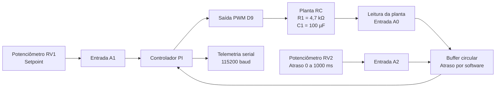

# Análise Computacional e Comparativa de Critérios de Estabilidade em Sistemas Dinâmicos

## Implementação prática — Engenharia da Computação

Este repositório reúne os arquivos da implementação prática desenvolvida para a trilha de **Engenharia da Computação** do projeto de pesquisa aplicada sobre análise de estabilidade pelo Critério de Nyquist.

A etapa documentada consiste em um protótipo de controle de uma planta RC, com firmware executado em um Arduino Uno virtual no Proteus. O firmware lê o setpoint, mede a saída da planta, aplica um atraso configurável à realimentação por meio de um buffer circular e calcula a ação de controle PI. As execuções são registradas por comunicação serial para posterior análise.

> **Escopo:** este repositório documenta a implementação e a co-simulação de firmware e circuito no Proteus. Ele não representa, por si só, uma montagem HIL física com microcontrolador real e planta externa. O atraso dos ensaios foi implementado por software sobre as amostras da medição.

## Visão geral do protótipo

O sistema utiliza dois potenciômetros: um define a referência (setpoint) e o outro determina o atraso aplicado à medição de realimentação. O Arduino calcula o controle e gera um sinal PWM que excita a planta RC.




## Ambiente de desenvolvimento

| Item | Configuração |
|---|---|
| Simulador de circuitos | Proteus 8 Professional — Release 8.13 SP0 (Build 31525) |
| Microcontrolador simulado | Arduino Uno R3 — ATmega328P |
| Clock do microcontrolador | 16 MHz |
| Linguagem do firmware | C++ (Arduino) |
| Ambiente de compilação | Arduino IDE |
| Comunicação serial | 115200 baud, 8 bits, sem paridade, 1 stop bit |
| Análise dos registros | Python 3 |

## Circuito eletrônico

A planta utilizada no protótipo é um circuito RC de primeira ordem.

| Componente | Valor / função |
|---|---|
| ARD1 | Arduino Uno R3 / ATmega328P |
| RV1 | Potenciômetro de 10 kΩ — ajuste do setpoint |
| RV2 | Potenciômetro de 10 kΩ — ajuste do atraso |
| R1 | Resistor de 4,7 kΩ |
| C1 | Capacitor eletrolítico de 100 µF |
| XSC1 | Osciloscópio virtual de quatro canais |
| XVT1 | Virtual Terminal para telemetria serial |

A constante de tempo nominal da planta é:

\[
\tau = R C = 4.700 \times 100\,\mu F = 0,47\,s
\]

### Ligações principais

| Origem | Destino | Descrição |
|---|---|---|
| Arduino D9 | R1 (4,7 kΩ) | Saída PWM do controlador |
| R1 | PLANT_OUT | Nó de saída da planta RC |
| PLANT_OUT | Arduino A0 | Medição da saída da planta |
| PLANT_OUT | C1 positivo | Capacitor da planta |
| C1 negativo | GND | Referência comum |
| RV1 — cursor | Arduino A1 | Referência do controlador |
| RV2 — cursor | Arduino A2 | Ajuste do atraso |
| Arduino D1/TX | Virtual Terminal RXD | Transmissão serial |
| Osciloscópio — canal A | Arduino D9 | Visualização do PWM |
| Osciloscópio — canal B | PLANT_OUT | Visualização da resposta RC |

As extremidades dos dois potenciômetros são conectadas a +5 V e GND. Todos os pontos de GND devem compartilhar a mesma referência.

## Firmware de controle

O código-fonte está em [`firmware/PID_Nyquist_Proteus_Arduino.ino`](firmware/PID_Nyquist_Proteus_Arduino.ino).

Embora a estrutura do firmware permita a inclusão do termo derivativo, os ensaios documentados utilizaram **Kd = 0**. Portanto, a configuração experimental registrada é um **controlador PI**.

| Parâmetro | Valor utilizado |
|---|---:|
| Ganho proporcional (Kp) | 1,40 |
| Ganho integral (Ki) | 1,00 |
| Ganho derivativo (Kd) | 0,00 |
| Período nominal de amostragem | 10 ms |
| Atraso configurável | 0 a 1000 ms |
| Resolução nominal do atraso | 10 ms |
| Tamanho do buffer circular | 101 posições |
| Saída de controle | PWM de 8 bits (0 a 255), pino D9 |
| Anti-windup | Integração condicional |

### Funcionamento do atraso

A leitura atual da planta, obtida em A0, é armazenada em um buffer circular. A posição de leitura é escolhida de acordo com o atraso solicitado pelo potenciômetro RV2. O valor recuperado do buffer é utilizado como realimentação pelo controlador.

Assim, o protótipo representa um **atraso variável de medição implementado em software**. Não há uma rede física ou um canal de comunicação externo inserindo o atraso.

### Telemetria serial

O Arduino transmite uma linha CSV por amostragem, com o seguinte cabeçalho:

```text
tempo_ms,setpoint_V,saida_V,saida_atrasada_V,pwm,atraso_ms
```

As colunas representam, respectivamente, o tempo decorrido, a referência em volts, a saída atual da planta, a saída utilizada na realimentação atrasada, o valor PWM e o atraso efetivamente aplicado.

## Como abrir e executar a simulação

1. Abra `proteus/AED.pdsprj` no Proteus 8.13 Professional.
2. Abra `firmware/PID_Nyquist_Proteus_Arduino.ino` na Arduino IDE.
3. Selecione **Arduino Uno** como placa e compile o firmware.
4. Exporte o arquivo HEX gerado pela compilação.
5. Nas propriedades do Arduino no Proteus, selecione o HEX em **Program File** e confirme o clock de 16 MHz.
6. Configure o Virtual Terminal para 115200 baud, 8-N-1.
7. Inicie a simulação e ajuste RV1 para a referência desejada e RV2 para o atraso do ensaio.
8. Observe D9 e PLANT_OUT no osciloscópio e registre a telemetria recebida no terminal.

O arquivo [`firmware/PID_Nyquist_Proteus_Arduino.hex`](firmware/PID_Nyquist_Proteus_Arduino.hex) acompanha o projeto como binário fornecido para a simulação. Sua estrutura Intel HEX e os checksums dos registros foram verificados. Essa verificação não comprova, isoladamente, que o binário foi gerado a partir da versão do `.ino` presente neste repositório. Para uma reprodução controlada, compile o código-fonte e utilize o HEX produzido por essa compilação.

## Ensaios documentados

Os registros disponibilizados contêm dez configurações de atraso, mantendo RV1 aproximadamente em 50%:

| Ensaio | RV2 | Atraso registrado |
|---:|---:|---:|
| 1 | 0% | 0 ms |
| 2 | 10% | 100 ms |
| 3 | 20% | 200 ms |
| 4 | 40% | 400 ms |
| 5 | 60% | 600 ms |
| 6 | 80% | 800 ms |
| 7 | 88% | 880 ms |
| 8 | 90% | 900 ms |
| 9 | 87% | 870 ms |
| 10 | 89% | 890 ms |

Os arquivos CSV individuais estão em [`dados/csv/`](dados/csv/). O resumo estatístico está em [`dados/resumo_ensaios.csv`](dados/resumo_ensaios.csv). O documento [`docs/evidencias/Evidencias_Proteus_10_ensaios.pdf`](docs/evidencias/Evidencias_Proteus_10_ensaios.pdf) reúne o esquema, as capturas do Proteus e os registros de telemetria. As capturas PNG individuais estão em `docs/evidencias/capturas/`.

### Interpretação dos registros

Nas janelas registradas, os ensaios com atrasos de 0, 100, 200 e 400 ms mostram a saída aproximando-se da referência. Com o aumento do atraso, as respostas passam a apresentar oscilações mais pronunciadas. Nos ensaios de maior atraso também há ocorrências de saturação do PWM.

Cada registro disponível cobre aproximadamente 9,4 a 10,0 segundos. Por isso, os dados atuais devem ser tratados como resultados exploratórios da simulação: não permitem, isoladamente, afirmar o atraso crítico experimental nem classificar definitivamente 880 ms ou 900 ms como estável ou instável. A saturação do PWM também deve ser considerada ao comparar a resposta não linear observada com a previsão obtida por um modelo linear.

## Análise dos dados

O script [`scripts/plotar_telemetria.py`](scripts/plotar_telemetria.py) lê os dez CSVs, atualiza o resumo estatístico e gera gráficos de resposta temporal e PWM na pasta `figuras/`.

O script [`scripts/validar_entrega.py`](scripts/validar_entrega.py) verifica a presença dos arquivos principais, os cabeçalhos e atrasos dos CSVs, os registros e checksums do HEX e a estrutura interna do projeto Proteus. Essa validação é estrutural; ela não compila o firmware nem executa a simulação.

Para instalar a dependência de geração dos gráficos e executar os scripts:

```bash
python -m pip install -r requirements.txt
python scripts/validar_entrega.py
python scripts/plotar_telemetria.py
```

## Organização do repositório

```text
.
├── firmware/
│   ├── PID_Nyquist_Proteus_Arduino.ino
│   ├── PID_Nyquist_Proteus_Arduino.hex
│   └── LEIA-ME_HEX.md
├── proteus/
│   └── AED.pdsprj
├── dados/
│   ├── csv/
│   │   ├── ensaio_000ms.csv
│   │   ├── ensaio_100ms.csv
│   │   ├── ...
│   │   └── ensaio_900ms.csv
│   └── resumo_ensaios.csv
├── figuras/
│   ├── respostas_temporais_10_ensaios.png
│   └── pwm_10_ensaios.png
├── scripts/
│   ├── plotar_telemetria.py
│   └── validar_entrega.py
└── docs/
    ├── Repasse_Tecnico_Para_Artigo.pdf
    ├── Repasse_Tecnico_Para_Artigo.docx
    ├── Enunciado_Projeto_Pesquisa.pdf
    └── evidencias/
        ├── Evidencias_Proteus_10_ensaios.pdf
        └── capturas/
```

## Relação com o projeto de pesquisa

O projeto de pesquisa mais amplo propõe o estudo e a comparação do Critério de Nyquist com Routh-Hurwitz, Lugar das Raízes e Diagrama de Bode, além da avaliação de sistemas de benchmark. Este repositório concentra-se na **implementação prática da trilha de Engenharia da Computação**: firmware, planta RC simulada, atraso variável na realimentação e coleta de resultados.

A implementação dos algoritmos gerais de Nyquist, Routh-Hurwitz, Lugar das Raízes, Bode e dos benchmarks A–D pertence ao núcleo computacional mais amplo do projeto e não é realizada pelo firmware Arduino aqui documentado.

## Documentação complementar

- [Relatório de repasse técnico — PDF](docs/Repasse_Tecnico_Para_Artigo.pdf)
- [Relatório de repasse técnico — DOCX](docs/Repasse_Tecnico_Para_Artigo.docx)
- [Enunciado do projeto de pesquisa](docs/Enunciado_Projeto_Pesquisa.pdf)
- [Evidências completas dos ensaios](docs/evidencias/Evidencias_Proteus_10_ensaios.pdf)
- [Orientações para publicação no GitHub](docs/COMO_SUBIR_GITHUB.md)

## Repositório

[github.com/Guilheme-collab/AED---NILSON](https://github.com/Guilheme-collab/AED---NILSON)
